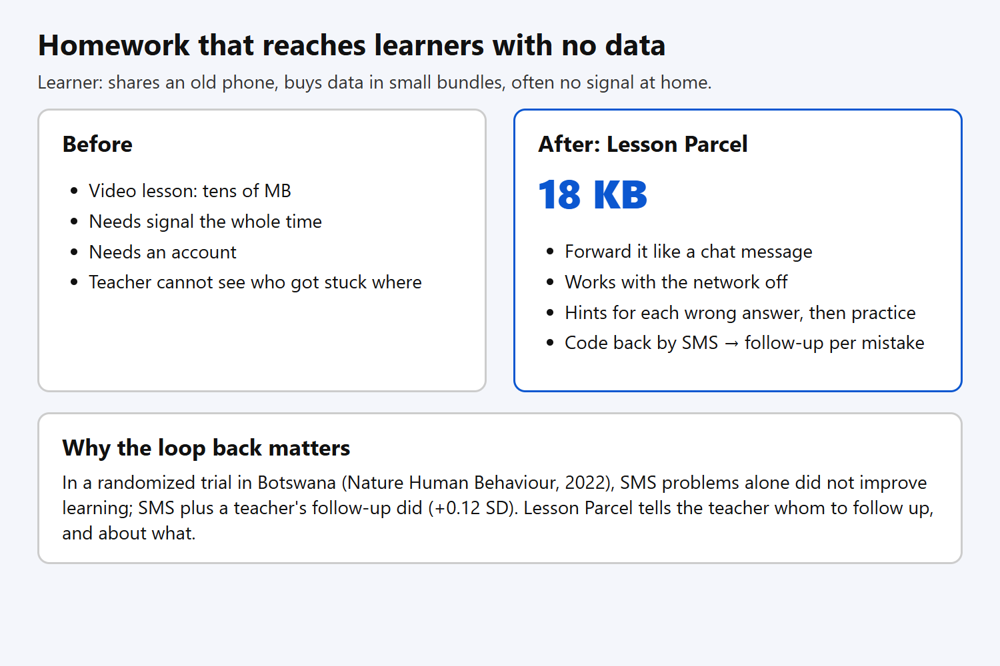

# Lesson Parcel

**Homework in one ~18 KB file that works offline on old shared phones.** Learners get a hint for the exact mistake they made, practise what they missed, and text a short code back. The teacher pastes the codes and gets a follow-up plan: who chose which wrong answer, with a ready-to-send message for each group.

Built for AccessED Hacks 2026 (door: *Connect*, plus *Interact* and *Afford*).



## Two ways to use it

### 1. Online demo (nothing to install)
- **Editor:** `https://Bo-Lee-Programming.github.io/lesson-parcel/`. Press **Try a lesson as a learner**, or edit the sample and press **Download lesson file**.
- **Sample lessons:** open `…/lessons/frac-lesson.html`, `water-lesson.html` or `foto-lesson.html` (Spanish). To try offline, save one to a phone, switch on airplane mode, and open it in the phone's browser.
- **Close the loop:** answer a few questions, copy the progress code, and paste it into section 3 of the editor with the same lesson loaded.

### 2. Downloadable build (works with no internet at all)
- **Offline editor:** `docs/lesson-parcel-editor.html` (about 52 KB, one file). Save it once; it then works from disk, including writing lessons and reading codes.
- **Lessons:** `docs/lessons/*.html`. Each is one file of about 18 KB that you can send by WhatsApp, Bluetooth or USB.
- Or use GitHub's **Code → Download ZIP** and open `docs/index.html`.

No server, no account and no personal information are needed, for learners or for judges.

## How it works
- The editor turns a lesson (reading parts plus multiple-choice questions with explanations) into **one self-contained HTML file**. The learner code is copied into the file from `docs/parcel.js`, so the editor and every lesson share one source.
- **Learners:**
  - Read aloud using the device's built-in speech.
  - Change the text size, switch to high contrast, and use everything with the keyboard.
  - Share one phone, with separate progress per learner (stored in localStorage).
  - Use English or Spanish controls, following the lesson's language.
  - If storage is blocked, the lesson still works and warns that progress will not be saved.
- **Progress code**, for example `FRAC-AMI-1113-R`: lesson code, 3-letter code name, one digit per question for the *first-try* answer (0 = not answered), and a check character that catches typos. It fits in one SMS.
- **Hints per wrong answer:** the teacher can write what a learner probably misunderstood when they pick each wrong option. A wrong answer shows that hint; the full explanation comes with the right answer or after a second wrong try.
- **Finish and practice:** a progress bar, a first-try score, and "Practice the ones I missed" (shuffled options; it does not change the code).
- **Follow-up plan:** the editor finds codes in any pasted SMS text, shows a class table, then groups learners by the wrong answer they chose first and drafts one message per group from that answer's hint (the sample messages fit in one SMS). This is the step that research says helps: in a randomized trial in Botswana, SMS practice alone did not improve learning, while SMS plus a follow-up did (Angrist et al., *Nature Human Behaviour*, 2022).

## Repository layout
| Path | What it is |
|---|---|
| `docs/` | The website (GitHub Pages serves this folder): `index.html`, `editor.js`, `parcel.js` (shared learner code), `samples.js` |
| `docs/lessons/` | Built sample lessons |
| `docs/lesson-parcel-editor.html` | Built one-file offline editor |
| `docs/screenshots/` | Gallery images, before/after comparisons (`before/` = Nov 9 version, `raw/` = current screenshots) |
| `tools/` | Build, test, screenshot and local server scripts |
| `tests/` | Test report and raw results |
| `video/` | Demo script, captions (`captions.srt`) and transcript |
| `DESIGN.md` | Design and comparison with related work (in Chinese) |
| `PRODUCT_REVIEW.md` | Product review (Nov 13): who it is for, evidence, similar tools, what we changed (in Chinese) |

## Deploy to GitHub Pages
1. Create a public repository named `lesson-parcel` and push this folder, leaving out `tools/node_modules/` (it is in `.gitignore`).
2. Go to **Settings → Pages → Build and deployment**, choose **Deploy from a branch**, branch `main`, folder `/docs`, and press **Save**.
3. After about a minute, the editor is live at `https://Bo-Lee-Programming.github.io/lesson-parcel/`.

## Develop and test
```
node tools/build-and-test.js        # rebuild sample lessons + offline editor, logic tests
cd tools && npm install && cd ..    # puppeteer-core, lighthouse (tests only)
node tools/serve.js 18431
NODE_PATH=tools/node_modules node tools/e2e.js   http://127.0.0.1:18431
NODE_PATH=tools/node_modules node tools/shots.js http://127.0.0.1:18431
```
`tests/TEST_REPORT.md` has the results and known gaps.

## Limitations
- Multiple choice and text only; no images or video yet, because they would make files much larger.
- Read-aloud quality depends on the voices installed on the device.
- The check character catches typos, not cheating. Codes help a teacher see where the class needs help; they are not for grading.
- Not yet tested with real learners or a real screen reader by ear (see the test report).

## Credits and disclosure
- All code was written during the event window, starting 2026-11-08. There is no pre-existing project.
- AI assistance: the code, tests and text were drafted with Claude (Anthropic) and reviewed by the author.
- No third-party runtime libraries. Development-only tools: puppeteer-core and Lighthouse (Apache-2.0).
- The sample lessons are synthetic. No real learner data is used.
- License: MIT (see LICENSE).
